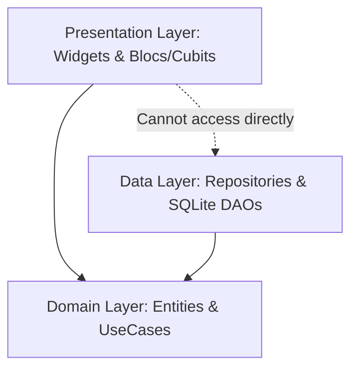
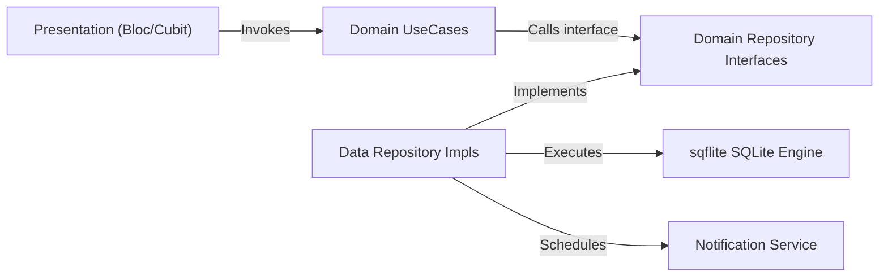

# Architecture Spine — Credit Bill System

## Design Paradigm

The system adopts **Feature-First Clean Architecture**. The application is partitioned into isolated feature modules (`cards`, `bills`, `analytics`, `emis`, `security`, `backup`). Each feature is organized into three strictly bounded layers:



* **Domain Layer (Core):** Pure Dart with zero Flutter or database dependencies. Contains business entities, repository interfaces, and isolated UseCases.
* **Data Layer (Infrastructure):** Implements domain repository interfaces, manages raw SQLite queries via `sqflite`, models JSON/map serializers, and interacts with device platform channels.
* **Presentation Layer (UI & State):** Flutter widgets observing state from `flutter_bloc` / Cubits. Blocs interact exclusively with Domain UseCases.

---

## Inherited Invariants

| Inherited | From parent | Binds here |
| --- | --- | --- |
| 100% Offline-First | `prd.md` §1 | All data persistence must be local on-device; zero remote network calls |
| Zero CVV / Full PAN Storage | `prd.md` §3 | Database schema strictly forbids storing CVV, expiration date, or full 16-digit card numbers |
| Safe Threshold 30% | `prd.md` §4.4 | Credit utilization health calculation must trigger alert banners above 30.0% ratio |

---

## Invariants & Rules



### AD-1 — Feature-First Isolation & Dependency Direction [ADOPTED]
- **Binds:** All code under `lib/`
- **Prevents:** Circular dependencies across features and tight coupling between UI widgets and database tables.
- **Rule:** 
  1. Dependencies flow strictly inward: Presentation $\rightarrow$ Domain $\leftarrow$ Data.
  2. A presentation widget or Bloc may never import or instantiate classes from `data/`.
  3. Cross-feature access must occur only through exported Domain entities or shared Core contracts (`lib/core/`).

### AD-2 — Primary Keys & Relational Schema Invariants [ADOPTED]
- **Binds:** `features/**/data/models/`, database migrations
- **Prevents:** Primary key collisions on export/import and orphaned bill/transaction records.
- **Rule:**
  1. All database primary keys must be non-empty UUID v4 strings (`TEXT PRIMARY KEY`).
  2. Foreign keys must be enforced (`PRAGMA foreign_keys = ON;`).
  3. Deletion or archival of a `Card` cascades or safely reassigns child `bills`, `transactions`, and `emis`.
  4. Database indexes are mandatory on `bills(card_id, due_date)` and `transactions(card_id, timestamp)`.

### AD-3 — UseCase Execution & Unidirectional Data Flow [ADOPTED]
- **Binds:** `features/**/presentation/bloc/`, `features/**/domain/usecases/`
- **Prevents:** Business logic leaking into UI widget trees or state management classes mutating database state directly.
- **Rule:**
  1. All state mutations must be triggered via an explicit `UseCase` returning `Future<Either<Failure, T>>` or typed result records.
  2. UI reacts strictly to immutable State emissions from Blocs/Cubits.

### AD-4 — Reactive Notification Reconciliation [ADOPTED]
- **Binds:** `features/bills/`, `features/cards/`, `core/services/notification_service.dart`
- **Prevents:** Phantom alerts for paid bills, missed alarms after device reboots, and out-of-sync notification offsets.
- **Rule:**
  1. Every mutation to a Bill (create, amount update, full settlement) or Card (due day edit) must invoke `NotificationReconciliationService.syncForBill(billId)`.
  2. Marking a bill as `Paid` must immediately cancel all pending local notification IDs tied to that bill's cycle.
  3. On app cold launch, an idempotent background reconciliation sweep verifies and reschedules any pending active alerts with `flutter_local_notifications`.

### AD-5 — App Lifecycle Obscuring & Biometric Challenge [ADOPTED]
- **Binds:** `features/security/`, `lib/app.dart`
- **Prevents:** Leaking unmasked financial figures in OS task switchers and unauthorized access upon resuming backgrounded apps.
- **Rule:**
  1. When biometric lock is enabled in user settings, transition to `AppLifecycleState.paused` or `inactive` must immediately render a privacy protection overlay over the root window.
  2. Resuming the application after $>30\text{ seconds}$ of backgrounding requires successful `local_auth` authentication before removing the privacy shield.

### AD-6 — Encrypted Backup Envelope & Schema Versioning [ADOPTED]
- **Binds:** `features/backup/`
- **Prevents:** Backward compatibility breaks when importing backups across app versions and plaintext leakage of financial archives.
- **Rule:**
  1. All exported JSON archives must follow the envelope standard:
     ```json
     {
       "schema_version": 1,
       "exported_at": "ISO-8601 UTC",
       "checksum": "SHA-256",
       "data": { "cards": [], "bills": [], "transactions": [], "emis": [] }
     }
     ```
  2. Password-protected exports must encrypt the payload using AES-256-GCM.
  3. The restore service must reject archives with `schema_version > current_supported_version` before performing any database transactions.

---

## Consistency Conventions

| Concern | Convention |
| :--- | :--- |
| **Naming (Files & Directories)** | `snake_case.dart` for all file names. Feature folders plural (`cards/`, `bills/`). |
| **Naming (Classes & Types)** | `PascalCase` for classes, Enums, and Typedefs. Suffix with architectural role: `CardBloc`, `CardRepository`, `CardLocalDataSource`, `CardEntity`, `CardModel`. |
| **Identifiers** | Canonical UUID v4 strings (e.g., `550e8400-e29b-41d4-a716-446655440000`). |
| **Timestamps & Dates** | ISO 8601 UTC strings (`YYYY-MM-DDTHH:mm:ssZ`) in SQLite and domain layer. Format to local timezone only inside Presentation widgets. |
| **Monetary Values** | Stored as `double` or integer cents with explicit two-decimal rounding rules. Never display raw unformatted numbers. |
| **Error Handling** | Functional `Failure` classes (`DatabaseFailure`, `AuthFailure`, `ValidationFailure`) returned in `Either<Failure, T>`. Blocs never catch untyped exceptions from the data layer. |

---

## Stack

| Component | Pinned Technology / Version |
| :--- | :--- |
| **Language & SDK** | Dart `^3.13.4`, Flutter SDK `^3.x` |
| **State Management** | `flutter_bloc: ^8.1.6` |
| **Local Relational DB** | `sqflite: ^2.3.3+1` with `path_provider: ^2.1.2` and `path: ^1.9.0` |
| **Notification Engine** | `flutter_local_notifications: ^17.2.1` with `timezone: ^0.9.4` |
| **Biometric Security** | `local_auth: ^2.2.0` |
| **Charts & Visualization** | `fl_chart: ^0.68.0` |
| **Data Immutability & Utilities** | `equatable: ^2.0.5`, `uuid: ^4.4.0`, `intl: ^0.19.0` |
| **Cryptography (Backups)** | `cryptography: ^2.7.2` (or `crypto: ^3.0.3`) |

---

## Structural Seed

```text
lib/
├── core/
│   ├── database/             # SQLite open helper, migrations, tables
│   ├── errors/               # Failure & Exception classes
│   ├── services/             # NotificationService, BiometricService, BackupService
│   ├── theme/                # Card gradient palettes, dark/light typography
│   └── utils/                # Date helpers, currency formatters
├── features/
│   ├── cards/
│   │   ├── data/             # CardModel, CardLocalDataSource, CardRepositoryImpl
│   │   ├── domain/           # CardEntity, CardRepository (interface), UseCases
│   │   └── presentation/     # CardBloc, CardWalletCarousel, AddCardScreen
│   ├── bills/
│   │   ├── data/             # BillModel, BillLocalDataSource, BillRepositoryImpl
│   │   ├── domain/           # BillEntity, BillRepository (interface), UseCases
│   │   └── presentation/     # BillBloc, BillCountdownWidget, SettleBillModal
│   ├── analytics/
│   │   ├── data/             # TransactionModel, TransactionLocalDataSource
│   │   ├── domain/           # TransactionEntity, CalculateUtilizationUseCase
│   │   └── presentation/     # AnalyticsBloc, UtilizationGauge, SpendDonutChart
│   ├── emis/
│   │   ├── data/             # EmiModel, EmiRepositoryImpl
│   │   ├── domain/           # EmiEntity, EmiRepository, AmortizationScheduleUseCase
│   │   └── presentation/     # EmiBloc, EmiListScreen, AddEmiDialog
│   ├── security/
│   │   ├── domain/           # SecuritySettingsEntity, CheckBiometricUseCase
│   │   └── presentation/     # SecurityBloc, BiometricLockOverlay
│   └── backup/
│       ├── data/             # BackupDataSource (export/import engine)
│       ├── domain/           # ExportBackupUseCase, RestoreBackupUseCase
│       └── presentation/     # BackupSettingsTile, ImportDialog
├── main.dart                 # App bootstrap, BlocProvider root, DB initialization
└── app.dart                  # MaterialApp with theme, lifecycle listener & routing
```

---

## Capability → Architecture Map

| Capability / Requirement | Lives in | Governed by |
| :--- | :--- | :--- |
| **FR-1 to FR-3 (Cards)** | `lib/features/cards/` | `AD-1`, `AD-2`, Clean Architecture |
| **FR-4 to FR-6 (Bills & Rollover)** | `lib/features/bills/` | `AD-1`, `AD-2`, `AD-3`, `AD-4` |
| **FR-7 (Due Date Reminders)** | `lib/core/services/` & `bills/` | `AD-4` (Reactive Notification Sync) |
| **FR-8 (Credit Utilization)** | `lib/features/analytics/` | `AD-3`, Inherited Invariant (30% threshold) |
| **FR-9 to FR-10 (Spend Analytics)** | `lib/features/analytics/` | `AD-1`, `fl_chart` stack |
| **FR-11 to FR-12 (EMI Tracker)** | `lib/features/emis/` | `AD-1`, `AD-2`, Relational Cascade |
| **FR-13 (Biometric App Lock)** | `lib/features/security/` | `AD-5` (Lifecycle Obscuring & Challenge) |
| **FR-14 (Encrypted Backup)** | `lib/features/backup/` | `AD-6` (Versioned AES-256 JSON Envelope) |

---

## Deferred

* **Post-MVP Android SMS Bill Listener Plugin:** Requires separate permission handler and native background isolate; intentionally deferred to v2 to preserve cross-platform simplicity.
* **Cloud Sync & Key Derivation:** Deferred until multi-device synchronization is scoped.
* **Automated Statement PDF Extraction:** Deferred until on-device ML/OCR text parsing engine is evaluated.
