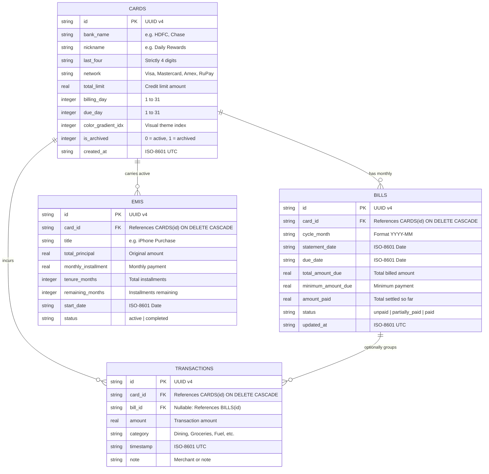
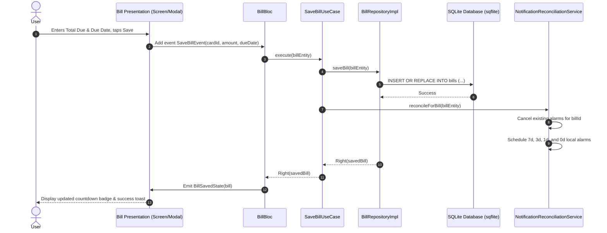
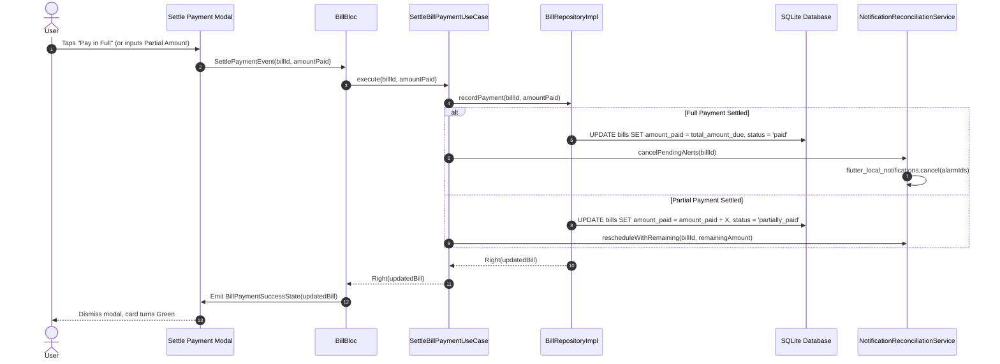
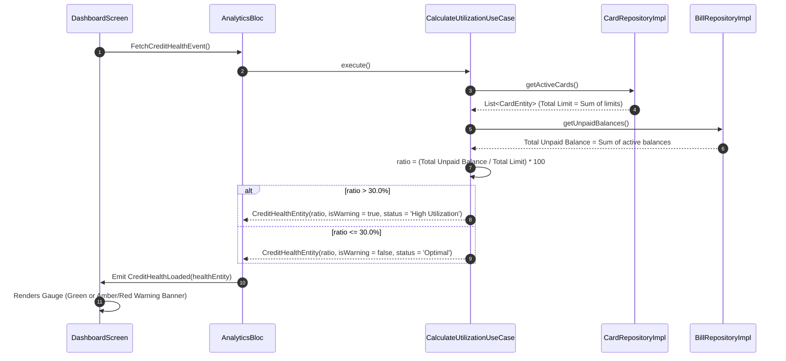

# Architecture & Data Flow Walkthrough: Credit Bill System

This visual walkthrough accompanies [`ARCHITECTURE-SPINE.md`](file:///D:/project/credit_bill_system/_bmad-output/planning-artifacts/architecture/architecture-credit_bill_system-2026-10-13/ARCHITECTURE-SPINE.md), detailing entity relationships, sequence interactions, and SQL database DDL for implementation.

---

## 1. Database Entity-Relationship Diagram (ERD)



---

## 2. Core Interaction Sequence Diagrams

### Sequence 1: Logging a Bill & Reactive Notification Scheduling
When a user updates a monthly statement bill, the domain layer coordinates storage, utilization recalculation, and background notification scheduling.



---

### Sequence 2: Bill Payment Settlement (Partial or Full)
When a bill is paid, the balance is recalculated and notifications are cancelled if settled in full.



---

### Sequence 3: Credit Utilization Calculation & 30% Threshold Alert
Real-time credit health calculation ensures users stay informed on revolving debt.



---

## 3. SQLite DDL Implementation Blueprint

```sql
-- Enable foreign key constraints
PRAGMA foreign_keys = ON;

-- 1. Cards Table
CREATE TABLE IF NOT EXISTS cards (
    id TEXT PRIMARY KEY,
    bank_name TEXT NOT NULL,
    nickname TEXT NOT NULL,
    last_four TEXT NOT NULL CHECK(length(last_four) = 4),
    network TEXT NOT NULL,
    total_limit REAL NOT NULL CHECK(total_limit > 0),
    billing_day INTEGER NOT NULL CHECK(billing_day BETWEEN 1 AND 31),
    due_day INTEGER NOT NULL CHECK(due_day BETWEEN 1 AND 31),
    color_gradient_idx INTEGER NOT NULL DEFAULT 0,
    is_archived INTEGER NOT NULL DEFAULT 0,
    created_at TEXT NOT NULL
);

-- 2. Bills Table
CREATE TABLE IF NOT EXISTS bills (
    id TEXT PRIMARY KEY,
    card_id TEXT NOT NULL,
    cycle_month TEXT NOT NULL,
    statement_date TEXT NOT NULL,
    due_date TEXT NOT NULL,
    total_amount_due REAL NOT NULL CHECK(total_amount_due >= 0),
    minimum_amount_due REAL NOT NULL DEFAULT 0.0 CHECK(minimum_amount_due >= 0),
    amount_paid REAL NOT NULL DEFAULT 0.0 CHECK(amount_paid >= 0),
    status TEXT NOT NULL CHECK(status IN ('unpaid', 'partially_paid', 'paid')),
    updated_at TEXT NOT NULL,
    FOREIGN KEY (card_id) REFERENCES cards(id) ON DELETE CASCADE
);

CREATE INDEX IF NOT EXISTS idx_bills_card_due ON bills(card_id, due_date);
CREATE INDEX IF NOT EXISTS idx_bills_status ON bills(status);

-- 3. Transactions Table
CREATE TABLE IF NOT EXISTS transactions (
    id TEXT PRIMARY KEY,
    card_id TEXT NOT NULL,
    bill_id TEXT,
    amount REAL NOT NULL CHECK(amount > 0),
    category TEXT NOT NULL,
    timestamp TEXT NOT NULL,
    note TEXT,
    FOREIGN KEY (card_id) REFERENCES cards(id) ON DELETE CASCADE,
    FOREIGN KEY (bill_id) REFERENCES bills(id) ON DELETE SET NULL
);

CREATE INDEX IF NOT EXISTS idx_transactions_card_time ON transactions(card_id, timestamp);

-- 4. EMIs Table
CREATE TABLE IF NOT EXISTS emis (
    id TEXT PRIMARY KEY,
    card_id TEXT NOT NULL,
    title TEXT NOT NULL,
    total_principal REAL NOT NULL CHECK(total_principal > 0),
    monthly_installment REAL NOT NULL CHECK(monthly_installment > 0),
    tenure_months INTEGER NOT NULL CHECK(tenure_months > 0),
    remaining_months INTEGER NOT NULL CHECK(remaining_months >= 0),
    start_date TEXT NOT NULL,
    status TEXT NOT NULL CHECK(status IN ('active', 'completed')),
    FOREIGN KEY (card_id) REFERENCES cards(id) ON DELETE CASCADE
);
```
